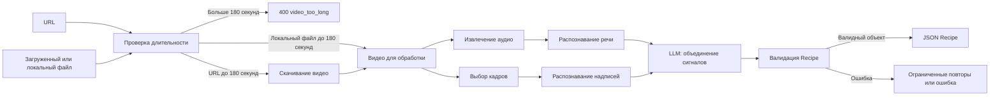

# Архитектура

## Граница сервиса

Модуль — серверный Python-сервис с FastAPI. Мобильный клиент отправляет URL через `POST /extract` или файл через `POST /extract/upload` и получает `Recipe`. Flutter или KMP еще не выбраны; это не меняет HTTP-контракт. Распознавание и тяжелые модели работают на сервере. Хранилище рецептов, недельное меню и доставка продуктов находятся за границами этого репозитория.

## Целевой пайплайн

Схема соответствует фактическому поведению: проверка длительности, скачивание, STT, выбор кадров, OCR и объединение через LLM реализованы и покрыты тестами (`make test`). Модели и лимиты настраиваются в `.env.example`; история изменений — в [CHANGELOG](../CHANGELOG.md).

API уже принимает непустой файл до 100 МиБ и сохраняет его в `TemporaryDirectory` под серверным именем. Папка удаляется после запроса, включая ошибки. `extract_recipe(source: str | Path)` и `probe_duration(source: str | Path)` принимают URL либо локальный путь. CLI с `--file` передает исходный локальный файл напрямую; скачивать его повторно не нужно.

## Ответственность модулей

| Файл | Ответственность |
| --- | --- |
| `src/api.py` | HTTP-запросы, схема ответа и преобразование ошибок |
| `src/main.py` | CLI поверх того же пайплайна |
| `src/config.py` | Конфигурация из окружения |
| `src/pipeline.py` | Порядок шагов и ограничение длительности |
| `src/downloader.py` | Длительность URL или локального файла; скачивание только для URL |
| `src/extractors/stt.py` | Аудио и распознавание речи |
| `src/extractors/frames.py` | Выбор кадров |
| `src/extractors/ocr.py` | Текст из кадров |
| `src/llm/fusion.py` | Сбор рецепта из распознанных сигналов |
| `src/models/` | Импорт `Recipe` из общего пакета |
| `packages/fropti-core-contracts/` | Единственное определение моделей и генерируемая JSON Schema |

Планирование меню не должно появляться внутри `fusion.py`: его результат — рецепт, пригодный для других модулей Fropti.

## Контракт

Источник `Recipe` — устанавливаемый пакет `fropti-core-contracts` 1.0.0 в `packages/fropti-core-contracts/`, совпадающий с upstream. Он не зависит от сервиса извлечения. API, CLI, синтетические примеры и другие Python-модули используют одну модель из `fropti_core_contracts.models`; мобильная команда использует сгенерированную JSON Schema и REST. Режимов с разными моделями нет. Поля, правила версий и подключение других команд описаны в [data_schema.md](data_schema.md).

## Эксплуатационные границы MVP

Синхронный API выбран для первого сквозного сценария. База данных и очередь не нужны для сценария «одно видео → один рецепт». Если измеренное время обработки не укладывается в таймаут мобильного клиента, согласуйте отдельный асинхронный контракт заданий до его реализации.

В лимит 10–12 часов входят локальный MP4, URL одной согласованной платформы, все этапы целевого пайплайна, общий контракт, тесты и три реальных прогона. Дополнительные платформы, очередь, GPU-оптимизация, UI, хранилище и публикация пакета — бонусы после MVP. Граф планирования и агрегированный список покупок находятся в соседних модулях: этот сервис передаёт им `Recipe`, но не реализует их выходные модели.

Длительность проверяется до тяжёлых этапов: для локальных файлов — из контейнера через `ffprobe`, для URL — из метаданных платформы; недостоверная длительность или её отсутствие отклоняется как `400 video_unreadable`. Защита скачивания по URL от SSRF и известные ограничения этой защиты описаны в разделе [«Безопасность»](#безопасность) ниже.

`ffmpeg` нужен для обработки медиа. Стек распознавания зафиксирован: faster-whisper (по умолчанию CPU, int8), PaddleOCR 2.x и любой OpenAI-совместимый LLM по `LLM_BASE_URL`/`LLM_MODEL`. Требования к CPU/GPU, ключи и стоимость вызовов описаны в [.env.example](../.env.example); full-образ Docker предзагружает модели при сборке, базовые тесты работают без них.

## Безопасность

Скачивание по URL защищено проверкой адресов против SSRF: разбор URL с проверкой схемы HTTP/HTTPS, allowlist хостов `ALLOWED_URL_HOSTS`, разрешение DNS с запретом частных, loopback, link-local, multicast и зарезервированных адресов (`400 ssrf_blocked`), ограничение размера `MAX_DOWNLOAD_BYTES`, таймауты `DOWNLOAD_TIMEOUT_SECONDS` и очистка временных файлов в `TemporaryDirectory`. Проверка адреса выполняется дважды — до получения метаданных и до скачивания — и всегда до любых тяжёлых этапов. Проверка синтаксиса HTTP URL сама по себе безопасностью не считается. Имя загруженного файла задаётся сервером и не управляет путями; ffmpeg и yt-dlp вызываются списком аргументов без shell-интерполяции входных значений; cookies аккаунта не коммитятся (`.gitignore` закрывает `cookies*.txt`), используются только по явной настройке ([SECURITY.md](SECURITY.md)) и передаются yt-dlp личной копией на каждый запуск: исходный файл только читается, одновременные запросы не пишут в один файл. Все внешние взаимодействия ограничены переменными конфигурации: размер загрузки и скачивания (`MAX_UPLOAD_BYTES`/`MAX_DOWNLOAD_BYTES`), таймауты медиапроцессов и внешних запросов (`FFMPEG_TIMEOUT_SECONDS`, `DOWNLOAD_TIMEOUT_SECONDS`, `LLM_TIMEOUT_SECONDS`), число повторов LLM (`LLM_MAX_RETRIES`, `LLM_NETWORK_RETRIES`); значения — в [.env.example](../.env.example), отказы проверены тестами.

### Известные ограничения MVP

- **Синхронный запрос без общей верхней границы времени.** Бюджеты повторов ограничены по отдельности, но перемножаются: (1 + `LLM_MAX_RETRIES`) × (1 + `LLM_NETWORK_RETRIES`) вызовов LLM — при значениях по умолчанию 6 вызовов по `LLM_TIMEOUT_SECONDS` (180 с), до ~18 минут в худшем случае внутри одного HTTP-запроса. Для MVP принято сознательно: сценарий «одно видео — один рецепт», конкурентных запросов мало; клиент обязан ставить собственный таймаут. Варианты закрытия после MVP: суммарный дедлайн пайплайна, асинхронная обработка с очередью и статусом задачи.
- **Лимит загрузки отфильтровывает крупные тела рано, но не гарантирует отказ до выгрузки.** Запрос с `Content-Length` больше `MAX_UPLOAD_BYTES` (+ запас на заголовки multipart) отклоняется middleware до чтения тела; запросы без `Content-Length` (chunked) или с заниженным заголовком принимаются полностью и проверяются по факту (`file.size` → `413 file_too_large`), а само тело уже успевает выгрузиться. Злонамеренный клиент всегда может слить произвольный объём до получения отказа; полноценное решение — ограничение на уровне реверс-прокси/веб-сервера (`client_max_body_size` и аналоги) перед приложением.
- **Гонка «проверка → использование» (класс «DNS-rebinding race»).** `_assert_public_host` разрешает хост через DNS один раз, а yt-dlp при последующем скачивании пере-разрешает тот же хост самостоятельно секундами позже. Злонамеренный или скомпрометированный DNS может на проверку вернуть публичный IP, а на скачивание — частный. Для MVP риск принят сознательно: хосты жёстко ограничены allowlist'ом заранее согласованных платформ, окно гонки измеряется секундами, а полноценное закрытие требует контроля исходящих соединений на сетевом уровне, а не только кода приложения.
- **HTTP-редиректы внутри yt-dlp.** Allowlist и DNS-проверка покрывают исходный хост; перенаправления, которые yt-dlp выполняет уже самостоятельно, повторно не проверяются. Условие приёмки «запрет … включая редиректы» ([evaluation.md](evaluation.md)) пока закрывается только для исходного хоста — это честно зафиксировано как остаточный риск, а не как выполненное требование.

Последние два ограничения одного класса «проверка → использование»; тесты с подменёнными внешними вызовами их не закрывают. Варианты закрытия после MVP: фильтрующий egress-прокси для процессов yt-dlp (например, через `--proxy`), изолированный сетевой namespace или отдельный контейнер для загрузчика, закрепление проверенного IP за запросом. За безопасность отвечает Люба Новохацкая ([evaluation.md](evaluation.md), обязательные условия приёмки).
